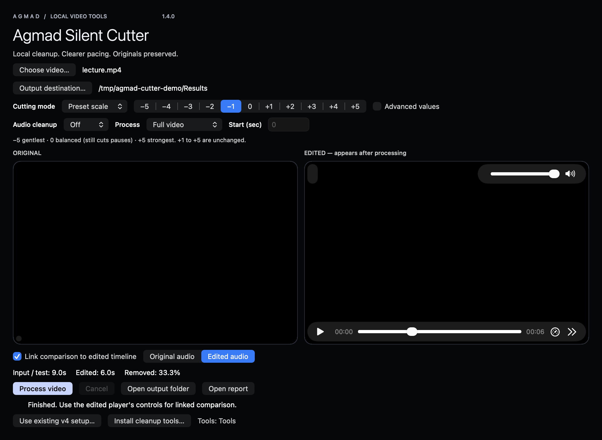

# AGMAD Silent Cutter

Local video silence cutting for macOS and Windows. Choose a video, tune its pacing, optionally clean speech, and compare the result with the original.



**1.4.0 release candidate · 20 October 2026.** The owner reports both 1.3 versions working well on their Mac and Windows devices. This candidate adds coordinated AGMAD styling, original icons, source packaging and release documentation. It keeps the working processing engine and settings. See [validation](docs/VALIDATION.md) for evidence and limits. It has not yet been publicly released.

## Get started

| Platform | Requirements | Instructions |
|---|---|---|
| Mac | Apple Silicon, macOS 14+, Homebrew for initial tools setup | [English guide](docs/MAC.md) |
| Windows | Intel/AMD 64-bit Windows; bundled Python/Qt | [دليل Windows بالعربية](docs/WINDOWS.ar.md) |

Release installers belong in GitHub Releases, not the source repository. Until publication, use the prepared local release files. Download links will be enabled on the existing [AGMAD product page](https://agmad.net/projects/silent-cutter/) after the release is approved and uploaded.

1. Select a video and output destination.
2. Start with level **0**, a **30-second test**, and audio cleanup **Off**.
3. Move toward **−5** to preserve more pauses, or toward **+5** for tighter cuts. Use **Custom** for guided numeric settings.
4. Choose **Noise** for steady background noise or **Music** for optional local voice separation.
5. Process, then review linked original/edited playback and lip sync before using the full result.

Original files are preserved. Every result uses a new folder containing an MP4, processing log, settings summary and comparison timeline. The desktop app processes media locally; initial tool/model setup requires internet. Music cleanup is optional and considerably heavier.

## What is included

- Unified −5…+5 scale; +1…+5 retain the original five presets exactly.
- Custom threshold, speech padding and minimum pause, with bounds checks.
- File/drop selection, saved output destination, full/30/60-second processing.
- Off / Noise / Music; cached cleaned audio when changing only cutting settings.
- Linked before/after preview, one audible side at a time, cancellation and diagnostics.
- Native Swift/AppKit Mac interface; Arabic Qt/PySide Windows interface.

No batch queue, transcription, subtitles or cloud processing is included in this GUI release. It edits the first audio track; cleanup produces mono speech and may introduce artifacts. [Processing details and limitations](docs/ARCHITECTURE.md).

## Documentation

[العربية](README.ar.md) · [Cutting guide](docs/CUTTING.md) · [Privacy](docs/PRIVACY.md) · [Troubleshooting](docs/TROUBLESHOOTING.md) · [Build from source](docs/BUILD.md) · [Validation](docs/VALIDATION.md) · [Release checklist](docs/RELEASE.md) · [Changelog](CHANGELOG.md)

## Development

```sh
python3 -m unittest discover -s tests -v
# On Apple Silicon with Xcode command-line tools:
bash macos/Source/build.command
# Package Windows; downloads version/hash-locked official runtime components:
python3 scripts/package_windows.py --output ../release-build
```

See [BUILD.md](docs/BUILD.md) for packaging, dependency replacement and optional music setup. CI runs source/settings checks and native build/runtime checks; a green CI badge does not certify audio quality or performance.

## License and credits

AGMAD application source, scripts and the original waveform icon are supplied under [MIT](LICENSE). AGMAD names remain identifiers, not a grant of trademark rights. Dependencies and models retain their own licenses: [third-party notices](THIRD_PARTY_NOTICES.md). The Windows release includes the applicable runtime license texts and dynamically linked Qt components. No model weights or sample recordings are redistributed.

The Mac app is ad-hoc signed, not Developer ID signed or notarized. The Windows package is not publisher-signed. Review platform-specific installation guidance; do not disable system protection globally.
